<picture>
  <source media="(prefers-color-scheme: dark)" srcset="assets/header-dark.svg">
  
</picture>

building things to understand them.
most of it breaks. that's the whole point.

---

the tools here are mostly for me. experiments in thinking out loud with code.
some worked, some got replaced by a model update, some just taught me something
and quietly retired. all of it was worth making.

---

right now i'm learning the more technical side of things.
math. physics. how models actually work. 
less vibes, more depth.

the gap between what i can imagine and what i can build
is the only metric that matters to me.

*curiosity is the whole game*

<picture>
  <source media="(prefers-color-scheme: dark)" srcset="assets/languages-dark.svg">
  
</picture>

<picture>
  <source media="(prefers-color-scheme: dark)" srcset="assets/stack-dark.svg">
  
</picture>

♡ [LoveSpark](https://lovespark.love) is a passion project ♡

Good Vibes Only 𓈗
